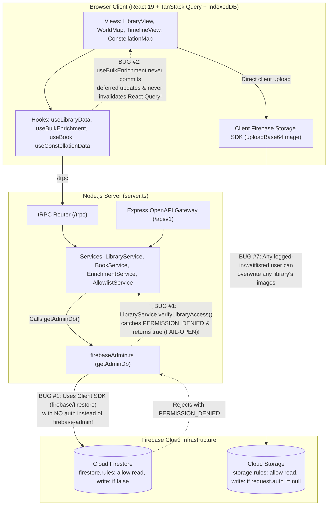

# Architectural & Structural Analysis: `NikhilS/shelfspace` (`book(ish)`)

## Executive Summary

`shelfspace` (**book(ish)**) has undergone an ambitious architectural evolution toward a **Unified Server-Authoritative Gateway** (`tRPC v11` + `Express OpenAPI v1`) backed by Cloud Firestore, TanStack Query (with IndexedDB persistence), Zustand, and Gemini AI enrichment pipelines.

However, because the codebase was migrated across multiple phases from a browser-direct Firebase app to a server-gated architecture, **critical structural seams between the database adapter, security rules, cache invalidation layer, and API routers are currently out of alignment**.



---

## 1. Incomplete tRPC Migration & Server Data-Plane Split-Brain: The tRPC Server Uses the Browser Client SDK (`firebase/firestore`) While Still Relying on Legacy Client-Firestore Fallbacks

### Severity: **Critical (P0 — Core Availability, Data Loss & RBAC Bypass)**

### Where
- [`src/services/server/firebaseAdmin.ts`](file:///tmp/shelfspace/src/services/server/firebaseAdmin.ts#L5-L75) (lines 5–75, 273–313)
- [`src/firebase.ts`](file:///tmp/shelfspace/src/firebase.ts#L11-L86) (lines 11–86) & [`firestore.rules`](file:///tmp/shelfspace/firestore.rules#L1-L16) (lines 1–16)
- [`src/services/server/libraryService.ts`](file:///tmp/shelfspace/src/services/server/libraryService.ts#L88-L100) (lines 88–100, 228–239, 585–596)
- [`src/services/server/enrichmentService.ts`](file:///tmp/shelfspace/src/services/server/enrichmentService.ts#L360-L365) (lines 360–365)
- [`src/server/auth/allowlistService.ts`](file:///tmp/shelfspace/src/server/auth/allowlistService.ts#L48-L58) & [`src/server/auth/waitlistService.ts`](file:///tmp/shelfspace/src/server/auth/waitlistService.ts#L6-L12)
- [`src/lib/clientBulkWriter.ts`](file:///tmp/shelfspace/src/lib/clientBulkWriter.ts#L1-L73) (lines 1–73)

### Architectural Issue: The Intended tRPC-Only Architecture vs. Reality
By design, **all client-server interactions in `shelfspace` are supposed to flow through tRPC (`/trpc`)**, and the browser client is **not** supposed to use Firestore client APIs (`firebase/firestore`) at all:
- [`src/firebase.ts`](file:///tmp/shelfspace/src/firebase.ts#L11-L12) explicitly deprecates client Firestore:
  ```ts
  // Deprecated: Client-side Firestore eliminated in favor of the Unified tRPC/OpenAPI Gateway
  export const db = null as unknown;
  ```
- [`firestore.rules`](file:///tmp/shelfspace/firestore.rules#L5-L7) is **correctly** locked down to `allow read, write: if false;`, which is the proper security posture when only the backend tRPC server is supposed to access Firestore.

However, the migration away from the Firestore Client SDK (`firebase/firestore`) is **critically incomplete across three layers**:

1. **The tRPC Backend Itself Uses the Browser Client SDK (`firebase/firestore`) Instead of `firebase-admin/firestore`:**
   - Every tRPC router (`libraryApi.ts`, `metadata.ts`, `auth.ts`, `apiKey.ts`, `user.ts`) delegates to backend services that call [`getAdminDb()`](file:///tmp/shelfspace/src/services/server/firebaseAdmin.ts#L273-L313).
   - Despite its name, [`src/services/server/firebaseAdmin.ts`](file:///tmp/shelfspace/src/services/server/firebaseAdmin.ts#L6-L28) only uses `firebase-admin` for `verifyIdToken()`. For database operations, `getAdminDb()` wraps `getFirestore`, `collection`, `doc`, `getDocs`, `setDoc`, `writeBatch`, etc. from **`firebase/firestore` (the browser Client Web SDK)**!
   - Because `firebase/firestore` connects as an **unauthenticated client** (`request.auth == null`) rather than a privileged Admin SDK service account, Firestore evaluates [`firestore.rules`](file:///tmp/shelfspace/firestore.rules#L5-L7) (`allow read, write: if false;`) against the **Node.js tRPC server itself**, rejecting every `getAdminDb()` call with `PERMISSION_DENIED`!

2. **Server Services Still Contain Obsolete Fallbacks Assuming the Client Talks to Firestore Directly:**
   Even though the frontend now uses tRPC exclusively (`db = null`), server-side error handlers still act as if the browser client has a direct Firestore connection and client-side security rules:
   - **Fail-Open RBAC in [`LibraryService.verifyLibraryAccess()`](file:///tmp/shelfspace/src/services/server/libraryService.ts#L88-L98):**
     ```ts
     if (
       errMsg.includes('PERMISSION_DENIED') ||
       errMsg.includes('permission-denied') ||
       errMsg.includes('Firebase config not found')
     ) {
       console.warn(
         `[LibraryService] Server-side Firestore permission unavailable (${errMsg}). Allowing authenticated user to proceed; client-side Firestore Security Rules strictly govern document writes.`,
       );
       return true;
     }
     ```
     In a tRPC-only architecture, **client-side Firestore Security Rules never govern writes**—the tRPC server (`verifyLibraryAccess`) is the **sole** authorization boundary! Returning `true` when Firestore fails makes every tRPC procedure fail-open.
   - **Deferred "Client Writer" Data Loss in [`EnrichmentService.triggerBatchEnrichment()`](file:///tmp/shelfspace/src/services/server/enrichmentService.ts#L360-L365):**
     ```ts
     } catch (writeErr) {
       console.warn(
         `[EnrichmentService] Firestore admin write deferred for book ${bookId} (client writer will commit):`,
         writeErr instanceof Error ? writeErr.message : writeErr,
       );
     }
     ```
     When the server write fails, `EnrichmentService` swallows the error assuming the frontend will commit `data.updates` via a client Firestore writer. Because [`useBulkEnrichment.ts`](file:///tmp/shelfspace/src/hooks/useBulkEnrichment.ts#L275-L307) was migrated to tRPC and no longer writes to Firestore from the client, the enriched metadata is silently lost!
   - **Broken Sync Catch Fallback in [`AllowlistService`](file:///tmp/shelfspace/src/server/auth/allowlistService.ts#L48-L58) & [`WaitlistService`](file:///tmp/shelfspace/src/server/auth/waitlistService.ts#L6-L12):**
     Both services wrap `getAdminDb()` in `try { return getAdminDb(); } catch { return admin.firestore(); }`. Because `getAdminDb()` returns the `firebase/firestore` adapter synchronously without throwing, the `catch` fallback to `admin.firestore()` is **dead code**—the `PERMISSION_DENIED` error throws asynchronously on `await doc.get()`, causing `AllowlistService.getPermissions()` to lock out all non-superadmin users!

3. **Leftover `firebase/firestore` Code in Client Helpers (`clientBulkWriter.ts` & `firebase.ts`):**
   - [`src/lib/clientBulkWriter.ts`](file:///tmp/shelfspace/src/lib/clientBulkWriter.ts#L1-L73) still imports `writeBatch`, `Firestore`, `doc`, `increment`, `serverTimestamp` from `'firebase/firestore'` and sets `const defaultMode = isTest ? 'firestore' : 'trpc'` (lines 55–62)—meaning unit tests run against a deprecated client-Firestore code path while production uses `trpc.book.batchUpsert`.
   - [`src/firebase.ts`](file:///tmp/shelfspace/src/firebase.ts#L19-L86) still contains `OperationType`, `FirestoreErrorInfo`, and `handleFirestoreError()`.

### How to Fix It
1. **Eliminate `firebase/firestore` Completely—Use `firebase-admin/firestore` on the Server (`firebaseAdmin.ts`) and Keep `firestore.rules` Locked (`if false`):**
   Replace the 250-line `firebase/firestore` client-SDK wrapper in [`src/services/server/firebaseAdmin.ts`](file:///tmp/shelfspace/src/services/server/firebaseAdmin.ts#L1-L314) with genuine `firebase-admin/firestore`:
   ```ts
   import admin from 'firebase-admin';
   import { getFirestore, FieldValue, FieldPath, type Firestore } from 'firebase-admin/firestore';

   let adminDb: Firestore | null = null;

   export function getAdminDb(): Firestore {
     if (!adminDb) {
       if (!admin.apps.length) {
         admin.initializeApp({ projectId: firebaseConfig?.projectId });
       }
       adminDb = getFirestore(
         admin.app(),
         firebaseConfig?.firestoreDatabaseId || '(default)',
       );
       adminDb.settings({ ignoreUndefinedProperties: true });
     }
     return adminDb;
   }
   export { FieldValue, FieldPath };
   ```
   - Keeping `firestore.rules` at `allow read, write: if false;` now works as designed: browser clients are blocked from touching Firestore directly, while the tRPC server authenticates via `firebase-admin/firestore` (Service Account / ADC) and bypasses `firestore.rules`.
2. **Remove All Legacy "Client Will Handle Firestore" Fallbacks on the Server:**
   - In [`LibraryService.verifyLibraryAccess()`](file:///tmp/shelfspace/src/services/server/libraryService.ts#L88-L98), remove the `return true` fallback on `PERMISSION_DENIED` / credential errors; always fail closed by throwing a `TRPCError`.
   - In [`EnrichmentService.triggerBatchEnrichment()`](file:///tmp/shelfspace/src/services/server/enrichmentService.ts#L360-L365), stop swallowing `writeErr` with `"client writer will commit"`; commit all batch enrichment updates atomically on the server via `adminDb.batch()`.
3. **Purge Remaining Client Firestore Remnants:**
   - Remove `'firebase/firestore'` imports and `'firestore'` mode from [`src/lib/clientBulkWriter.ts`](file:///tmp/shelfspace/src/lib/clientBulkWriter.ts#L1-L73) (or delete `ClientBulkWriter` entirely since `useAddBooks` and `useSpruceUp` already call `trpc.book.batchUpsert` directly), and remove `db` / `handleFirestoreError` from [`src/firebase.ts`](file:///tmp/shelfspace/src/firebase.ts#L11-L86).


---

## 2. Broken Enrichment Persistence & Missing React Query Cache Invalidation (`EnrichmentService` vs. `useBulkEnrichment` & `useConstellationData`)

### Severity: **High (P0 — Data Loss, Stale UI State & Redundant LLM Billing)**

### Where
- `src/services/server/enrichmentService.ts` (lines 332–376)
- `src/hooks/useBulkEnrichment.ts` (lines 200–359)
- `src/hooks/useConstellationData.ts` (lines 45–320)

### Architectural Issue
1. **Swallowed Server Writes with Uncommitted `updates` Payload:**
   In `EnrichmentService.triggerBatchEnrichment()` (lines 360–365), when writing extracted metadata to `booksRef` or `bookDetailsRef` fails, the server catches `writeErr`, logs:
   ```ts
   console.warn(`[EnrichmentService] Firestore admin write deferred for book ${bookId} (client writer will commit):`, ...);
   ```
   and returns `{ status: 'success', processedCount: results.length, results, updates: updateTasks }`.
   However, the client caller `useBulkEnrichment.ts` (lines 275–307) **only iterates over `data.updates` to log messages to `DebugTelemetryEngine`—it never commits `data.updates` via `ClientBulkWriter` or `trpcVanilla.book.batchUpsert`!** If the server write fails, the Gemini extraction results are silently discarded while the UI toasts `"Successfully enriched library books!"`.
2. **Zero React Query Cache Invalidation After Backfill:**
   `useBulkEnrichment.ts` is used by `WorldMap.tsx` (for `geoMetadata`), `TimelineView.tsx` (for `temporalMetadata`), and `ManualEnrichmentSection.tsx`. When `useBulkEnrichment` finishes enriching batches on the server, **it never calls `utils.book.list.invalidate({ libraryId })` or updates the TanStack Query cache (`utils.book.list.setData`)**!
   Because `queryClient.ts` configures `staleTime: 5 minutes` and `gcTime: 7 days` backed by IndexedDB, `useLibraryData` continues serving the pre-enrichment `books` array from cache—meaning newly geocoded pins on `WorldMap` and historical eras on `TimelineView` **do not appear** after enrichment completes!
3. **`useConstellationData` Re-Runs Full UMAP + K-Means + Gemini Naming on Every Mount:**
   Although the database schema (`src/schemas/book.ts`, `src/services/server/bookService.ts`) explicitly supports `clusterCoordinates: {x, y}` in `bookDetails` and `bookDetailsMetadata.hasClusterCoordinates`, `useConstellationData.ts` (lines 74–297):
   - Downloads **every** `bookDetails` document (including raw float embedding arrays) in chunks of 50 on every mount,
   - Re-runs 400-epoch UMAP projection in the Web Worker (`umapWorker.ts`),
   - Re-runs K-Means clustering,
   - Calls Gemini (`trpc.gemini.generateClusterNames.useMutation()`) to generate cluster names **every single time the user navigates to the Constellation tab**, and **never saves `clusterCoordinates` or `clusterNames` back to Firestore**!

### How to Fix It
1. **Atomic Batch Writes in `EnrichmentService`:** Commit `booksRef` and `bookDetailsRef` updates in `EnrichmentService.triggerBatchEnrichment` using `db.batch()` (rather than fire-and-forget per-document `.update()` calls inside `Promise.all` that swallow errors).
2. **Optimistic Cache Merge + Invalidation in `useBulkEnrichment.ts`:**
   Inject `const utils = trpc.useUtils();` into `useBulkEnrichment`. As each batch resolves (`data.updates`), merge `update.payload` into `utils.book.list.setData({ libraryId }, ...)` so markers/timeline nodes appear live on screen as each batch finishes, and call `await utils.book.list.invalidate({ libraryId })` in `finally`.
3. **Persist `clusterCoordinates` and `clusterNames` in `useConstellationData.ts`:**
   When `validBooks.every(b => b.clusterCoordinates)` is true and `library.clusterNames` exists, render `plotData` immediately in $O(N)$ time without downloading embedding vectors, running UMAP, or calling Gemini. Only recompute and persist via `trpcVanilla.book.batchUpsert` when new books lack `clusterCoordinates` or when the user clicks **Recluster**.

---

## 3. Unbounded Catalog Loading & Broken Pagination/Filtering in `BookService.listBooks`

### Severity: **High (P1 — Scalability & API Correctness)**

### Where
- `src/services/server/bookService.ts` (lines 592–684)
- `src/services/server/libraryService.ts` (lines 247–403, deprecated duplicate `getFilteredBooks`)
- `src/hooks/useLibraryData.ts` (lines 73–82)

### Architectural Issue
1. **`options.cursor` is Completely Ignored in `BookService.listBooks`:**
   Look at `BookService.listBooks` (`src/services/server/bookService.ts`, lines 592–684):
   - It accepts `options?: { filters?: ...; limit?: number; cursor?: string }` and returns `nextCursor` (line 679).
   - **Yet `options.cursor` is never read or passed to `query.startAfter(...)` anywhere in the method!** Calling `GET /api/v1/libraries/:id/books?limit=50&cursor=abc` or `trpc.book.list` with a `cursor` always returns the first page of books.
2. **In-Memory Filtering *After* `.limit(limitCount)` Returns Empty Pages:**
   `BookService.listBooks` applies `query = query.limit(limitCount)` (line 618) *before* filtering `books` in JavaScript for `options.filters.missingMetadata` (lines 659–675). Furthermore, `options.filters.primaryGenre` and `options.filters.status` are declared in the parameter type (lines 598–599) but **are completely unimplemented** in the function body. If `limit=50` and `missingMetadata='geo'`, and the 50 most recently added books already have `geoMetadata`, `listBooks` returns `books: []` even if 500 older books are missing `geoMetadata`.
3. **Hard 1,000-Book Truncation Across the Web App:**
   `useLibraryData.ts` calls `trpc.book.list.useQuery({ libraryId })` with no `limit`, hitting `const limitCount = options?.limit ?? 1000` in `BookService.listBooks`. Libraries with >1,000 volumes are silently truncated at 1,000 books in all client views, search/filter hooks (`useBookFilters`), duplicate detection (`useSpruceUp`), and CSV export.
4. **Dead Duplicate Code:** `LibraryService.getFilteredBooks` (`src/services/server/libraryService.ts` lines 247–403, 156 lines) is an unused duplicate of `BookService.listBooks`.

### How to Fix It
1. Implement cursor pagination in `BookService.listBooks` (`if (options?.cursor) { const snap = await booksCol.doc(options.cursor).get(); if (snap.exists) query = query.startAfter(snap); }`).
2. Push filters (`primaryGenre`, `userStatuses.${userId}`, `enrichmentStatus.${kind}`) into Firestore `.where()` constraints before `.limit()`, and implement the missing `primaryGenre` and `status` filters.
3. Remove the dead `LibraryService.getFilteredBooks` method.

---

## 4. `bookCount` Drift & Orphaned `reviews` Subcollections in `BookService.batchUpsert` and `LibraryService.deleteLibrary`

### Severity: **High (P1 — Data Integrity)**

### Where
- `src/services/server/bookService.ts` (lines 333–535)
- `src/services/server/libraryService.ts` (lines 754–800)

### Architectural Issue
1. **`bookCount` Drifts on `upsert`, Duplicate `create`, or Idempotent `delete`:**
   In `BookService.batchUpsert()` (`src/services/server/bookService.ts` lines 379–522):
   - When `input.books` is passed with `id` specified and no `action`, line 379 defaults `action` to `'upsert'`, which maps to `op.type = 'set'` with `op.merge = true` (lines 411–416).
   - In the batch loop, `op.type === 'set' && op.merge === true` enters the `else` branch (`updatedCount++`, line 487), **never incrementing `addedCount`** even when creating a brand-new book document!
   - Conversely, if `op.type === 'delete'` is called for a `bookId` that does not exist in Firestore, `deletedCount++` unconditionally decrements `library.bookCount` by `-1` (driving `bookCount` negative or out of sync with `books.length`).
2. **Orphaned `reviews` Subcollections Violate Golden Rule #7:**
   - While `BookService.deleteBook()` (lines 288–305) queries and deletes `libraries/{libraryId}/books/{bookId}/reviews`, **neither `BookService.batchUpsert()` (lines 442–446) nor `LibraryService.deleteLibrary()` (lines 764–799) deletes the `reviews` subcollection**! Deleting books in bulk or deleting a library leaves orphaned `reviews` documents permanently in Firestore.

### How to Fix It
1. **Use `admin.firestore().recursiveDelete(libRef)`** in `LibraryService.deleteLibrary()` (available natively in `firebase-admin/firestore`), which recursively purges `books`, `bookDetails`, `allowedDuplicates`, and nested `reviews` subcollections without manual batch loops.
2. **Use Firestore `count()` Aggregation to Reconcile `bookCount`:** Instead of computing `netCountDelta = addedCount - deletedCount` blindly from client operation types in `batchUpsert`, commit the batch operations first and then set `bookCount` authoritatively via `(await booksCollection.count().get()).data().count`.

---

## 5. Dual-Cache Anti-Pattern in `useBook.ts` (Violating State Architecture Golden Rule #4)

### Severity: **Medium-High (P1 — Frontend State Desynchronization)**

### Where
- `src/pages/book-details/useBook.ts` (lines 55–148, 184–363)

### Architectural Issue
`docs/evergreen/README.md` (Golden Rule #4) explicitly mandates: *"TanStack Query must never be used as a manual key-value store. It is reserved for declarative queries and optimistic mutations."*

Yet `src/pages/book-details/useBook.ts` maintains **two parallel TanStack Query cache hierarchies for the same book**:
1. It queries `trpc.book.get.useQuery({ libraryId, bookId })` (lines 55–76), which caches under tRPC's key `[['book', 'get'], { input: { libraryId, bookId }, type: 'query' }]`.
2. A `useEffect` (lines 90–102) copies `trpcBookQuery.data` into two manual keys: `['bookBase', libraryId, bookId]` and `['bookDetails', libraryId, bookId]`.
3. Two synthetic `useQuery` calls (lines 104–130) wrap those manual keys with synchronous `queryFn: () => (rawBook as Book) || null` closures.
4. All optimistic mutations (`updateReadingStatusMutation`, `updateBookMutation`, `updateBookOptimistically`) mutate `['bookBase', libraryId, bookId]` and `['bookDetails', libraryId, bookId]`, **never updating or invalidating `utils.book.get` or `utils.book.list`!**
5. Consequently, when the user edits a book or changes its reading status on `BookDetailsView` and clicks "Back to Library", `LibraryView` (`trpc.book.list`) still renders the stale status/metadata for up to 5 minutes (`staleTime`)!

### How to Fix It
- Remove the `['bookBase', ...]` and `['bookDetails', ...]` `useQuery` hooks and the `useEffect` cache-copying bridge in `useBook.ts`.
- Read `book` directly from `trpc.book.get.useQuery`.
- In `updateReadingStatusMutation` and `updateBookMutation`, apply optimistic updates to `utils.book.get.setData({ libraryId, bookId }, ...)` and `utils.book.list.setData({ libraryId }, ...)`, and invalidate both in `onSettled`.

---

## 6. Dual API Gateway Duplication & Drift Between tRPC (`/trpc`) and Express REST (`/api/v1`)

### Severity: **Medium (P2 — Maintainability & API Consistency)**

### Where
- `src/server/trpc/routers/libraryApi.ts` (lines 152–372)
- `src/server/trpc/routers/metadata.ts` (lines 88–121)
- `src/server/api/v1/router.ts` (lines 1–303)
- `src/server/api/v1/openapi.ts`

### Architectural Issue
1. **Unused OpenAPI Metadata on tRPC Procedures:** `bookApiRouter` (`src/server/trpc/routers/libraryApi.ts`) decorates procedures with `.meta({ openapi: { method: 'POST', path: '/v1/libraries/{libraryId}/books', ... } })`. However, `trpc-to-openapi` is not used to serve `/api/v1` or generate `/api/v1/openapi.json`.
2. **Hand-Rolled Express Router & Static OpenAPI Spec:** `src/server/api/v1/router.ts` duplicates every endpoint in Express, manually parsing query parameters, calling `safeParse`, and mapping errors (`const code = error?.code === 'NOT_FOUND' ? 404 : error?.code === 'FORBIDDEN' ? 403 : 500`—which maps `BAD_REQUEST` and `UNAUTHORIZED` to HTTP `500`!). Meanwhile, `src/server/api/v1/openapi.ts` is a 12.6 KB static file maintained by hand.
3. **Redundant Procedure Aliases:** `bookApiRouter` exposes duplicate endpoints (`create` + `createBook`, `update` + `updateBook`, `delete` + `deleteBook`, `list` + `listBooks`), and `metadataRouter.bulkFetch` duplicates `enrichmentApiRouter.trigger`.

### How to Fix It
- Have `/api/v1` Express routes delegate directly to `appRouter.createCaller(secContext)` (or wire `trpc-to-openapi` middleware) so authentication, `libraryProcedure` RBAC checks, Zod input validation, and HTTP status code mapping have a single source of truth.
- Remove the legacy procedure aliases (`createBook`, `updateBook`, `deleteBook`, `listBooks`, `metadata.bulkFetch`).

---

## 7. Cloud Storage Security Vulnerability, Synchronous Disk I/O in `geolocation.ts`, and Unbounded Server Payloads

### Severity: **Medium-High (P1 — Security & Server Performance)**

### Where
- `storage.rules` (lines 6–14) & `src/services/db/storage.ts` (lines 10–36)
- `src/services/server/geolocation.ts` (lines 60–74, 127, 151)
- `server.ts` (lines 73–74)
- `src/lib/clientBulkWriter.ts` (lines 55–62)

### Architectural Issue
1. **Cross-Tenant Overwrite & Read Vulnerability in `storage.rules`:**
   While `firestore.rules` is closed (`allow read, write: if false;`), `storage.rules` allows **any authenticated Firebase user** to read and write any file under `/libraries/{libraryId}/{allPaths=**}`:
   ```
   match /libraries/{libraryId}/{allPaths=**} {
     allow read: if request.auth != null;
     allow write: if request.auth != null; // Refine based on ownership if needed
   }
   ```
   Because `uploadBase64Image()` (`src/services/db/storage.ts`) uploads directly from the browser using the client Firebase Storage SDK to predictable paths (`libraries/${libraryId}/hero.png` and `libraries/${libraryId}/books/${bookId}/cover.png`), **any signed-in user (including unapproved waitlisted users or viewers of another user's library) can overwrite or delete any library's hero banner or book covers**.
2. **Main-Thread Event Loop Blocking via `fs.writeFileSync` in `geolocation.ts`:**
   In `src/services/server/geolocation.ts` (`persistToDisk()`, line 70), every geocoding cache update serializes the entire `cache` Map and calls **`fs.writeFileSync('.cache/geocache.json', JSON.stringify(obj))`** synchronously on the Node.js event loop. Furthermore, `.cache/geocache.json` is committed to the git repository (`.cache/geocache.json` is tracked in git tree!) and gets mutated during runtime/tests.
3. **Global `50mb` JSON Body Limit on All Routes (`server.ts`):**
   `server.ts` mounts `app.use(express.json({limit: '50mb'}))` globally before authentication runs, allowing unauthenticated callers to force the Node.js server to parse 50 MB JSON payloads into memory.
4. **Test-vs-Production Divergence in `ClientBulkWriter`:**
   In `src/lib/clientBulkWriter.ts` (lines 55–62), `const defaultMode = isTest ? 'firestore' : 'trpc'`. This means unit tests exercise the legacy `firestore` WriteBatch path while production runs the `trpc` `batchUpsert` path!

### How to Fix It
1. **Move Image Uploads Behind the Server Gateway & Lock `storage.rules`:** Close client writes in `storage.rules` (`allow write: if false;`) and upload images server-side via `firebase-admin/storage` inside a `libraryProcedure('editor')` tRPC mutation after verifying library edit permissions and MIME/size limits.
2. **Make Disk Cache Asynchronous & Debounced (and Untrack `.cache/geocache.json`):** Replace `fs.writeFileSync` in `geolocation.ts` with a debounced `fs.promises.writeFile`, and add `.cache/` to `.gitignore`.
3. **Scope Body Limits & Unify `ClientBulkWriter`:** Apply a strict default JSON limit (`1mb`) globally and only allow larger payloads (`15mb`) on authenticated image-extraction routes; remove `'firestore'` mode from `ClientBulkWriter` so tests and production test the exact same `trpc` batching code.

---

## Prioritized Remediation Roadmap

| Priority | Action Item | Primary Files Affected |
| :--- | :--- | :--- |
| **P0 (Immediate)** | Replace `firebase/firestore` client SDK shim with genuine `firebase-admin/firestore` (`ignoreUndefinedProperties: true`) and remove fail-open `return true` in `LibraryService.verifyLibraryAccess`. | `src/services/server/firebaseAdmin.ts`, `src/services/server/libraryService.ts`, `src/server/auth/allowlistService.ts` |
| **P0 (Immediate)** | Fix `useBulkEnrichment` to merge/invalidate `trpc.book.list` query cache on batch completion and ensure `EnrichmentService` writes atomically without swallowing errors. | `src/hooks/useBulkEnrichment.ts`, `src/services/server/enrichmentService.ts` |
| **P1 (High)** | Eliminate synthetic `['bookBase']` / `['bookDetails']` queries in `useBook.ts`; wire optimistic updates and invalidation directly to `utils.book.get` and `utils.book.list`. | `src/pages/book-details/useBook.ts` |
| **P1 (High)** | Persist UMAP `clusterCoordinates` and `clusterNames` in `useConstellationData.ts` so Constellation Map loads in $O(N)$ without re-running UMAP/Gemini on every page visit. | `src/hooks/useConstellationData.ts`, `src/services/server/bookService.ts` |
| **P1 (High)** | Implement `options.cursor` (`startAfter`) and pre-limit Firestore filtering in `BookService.listBooks`; reconcile `bookCount` via `count()` aggregation and use `recursiveDelete` on library/book deletion. | `src/services/server/bookService.ts`, `src/services/server/libraryService.ts` |
| **P1 (High)** | Lock `storage.rules` (`allow write: if false`) and route cover/hero uploads through a `libraryProcedure('editor')` server endpoint. | `storage.rules`, `src/services/db/storage.ts` |
| **P2 (Medium)** | Unify `/api/v1` Express routes with `appRouter.createCaller()`, remove duplicate tRPC procedure aliases, and replace `fs.writeFileSync` in `geolocation.ts` with debounced async writes. | `src/server/api/v1/router.ts`, `src/server/trpc/routers/libraryApi.ts`, `src/services/server/geolocation.ts` |
